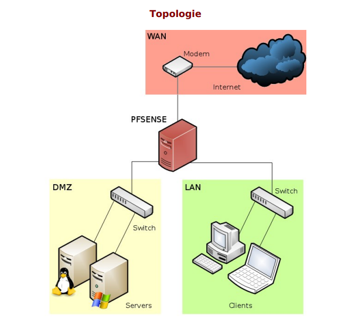

# TP Pfsense / DMZ

<aside>
🛠

# TP B2 LUCZAK — Jarod Houyelle — SIO SISR

</aside>

<aside>
📰

# Mise en situation :

La société Vikor désire installer un serveur Web au sein de son
architecture réseau ,ce serveur doit être accessible depuis le LAN de
l’entreprise ainsi que de « l’extérieur » ,à savoir internet.
Afin de sécuriser au maximum son réseau ,le choix de PfSense a été fait
en raison de sa flexibilité et du nombre de fonctionnalités disponibles.

</aside>

<aside>
📌

# Etape 1 : Installer PfSense sur une VM dotée de 3 interfaces (LAN, WAN, DMZ)

</aside>

Pour l’installation de PfSense il va nous falloir une VM avec 3 interfaces (Une pour le WAN, LAN, DMZ) l’interface WAN seras bridger sur la carte réseau et les deux autres seront des cartes virtuelles 

Je vais utiliser la VMBR0 pour le WAN, la VMBR1 pour le LAN, et la VMBR2 pour la DMZ

Maintenant que tout est prêt on va pouvoir commencer l’installation de PfSense 

Quand on commence l’installation de PfSense, on va nous demander de choisir une interface pour la patte WAN du PfSense, je vais choisir “inet0” ce qui équivaut à ma VMBR0 qui elle est bridger 

Ensuite il me demande la même chose pour le LAN donc je vais choisir “inet1” qui équivaut à ma VMBR1 qui elle est virtuelle 

Une fois arriver ici on va nous demander de choisir la version de PfSense, je choisis donc la plus récente. 

---

<aside>
📌

# Etape 2 : Mise en place d’un serveur WEB (DMZ)

</aside>

Je vais mettre en place un serveur LAMP qui sera relié à mon interface DMZ, ce serveur LAMP me servira de site vitrine pour la DMZ, j’ai choisi d’utiliser un Template que j’avais déjà d’un serveur LAMP, j’ai juste a changer l’ip par (192.168.10.10)

---

<aside>
📌

# Etape 3 : Configuration du PfSense

</aside>

Pour accéder à l’interface du PfSense on va utiliser une autre VM afin de se connecter à l’interface WEB, pour se faire je vais prendre une Template d’une VM Windows 11 et nous allons lui attribuer la même interface que celle utilisé pour le LAN car le PfSense se configure sur la patte LAN. 

Je vais donc attribuer la VMBR1 à la machine pour administrer le PfSense

Une fois la VM lancer on va lui attribuer une IP qui est dans le même réseau que celle du LAN (192.168.1.1), je choisis donc (192.168.1.2) une fois que c’est fait, j’ouvre mon navigateur et je tente une connexion sur (192.168.1.1). 

J’arrive sur cette page ou je dois me connecter, les logs par défauts sont : 

identifiants : admin

mot de passe : pfsense

Une fois connecter on nous demande directement de changer de mot de passe pour des raisons de sécurité, je choisis donc “sio@2026” comme nouveau mot de passe

Pour commencer la configuration du PfSense on va d’abord activer l’interface DMZ, pour ce faire on va se rendre dans interfaces —> DMZ et cocher “enable interface” 

---

## Création des règles :

Règle dans le DMZ | Block DMZ —> LAN 
Elle interdit à toute machine de la DMZ d'envoyer du trafic vers une machine du LAN, c’est ce qui protège le réseau interne 

Règle dans le WAN | Pass 
Autorise le trafic TCP arrivant depuis Internet (WAN), de n’importe quelle pc , à destination de 192.168.10.10 (DMZ)

Règles dans le WAN : 

Donc si j’essaye de me connecter au sur l’IP du WAN 192.168.20.172 en utilisant une machine hors réseau on doit me rediriger vers le site vitrine (DMZ)

---

<aside>
📌

# Etape 4 : Tests de connexions

</aside>

Pour vérifier que tout fonctionne, je vais maintenant tenter de me connecter sur les différentes interfaces 

TEST 1 : test de connexion au WAN depuis un pc du réseau (192.168.20.x) afin d’être rediriger vers la DMZ (192.168.10.10) 
je vais me connecter sur (http://192.168.20.172)

On peut voir que tout fonctionne bien et que l’on est bien redirigé vers la DMZ car on arrive sur le serveur WEB 

---

TEST 2 : Tentative de connexion a la DMZ depuis le LAN (192.168.1.1)

---

<aside>
🎯

# TP2 PfSense/AddOn

</aside>

<aside>
📰

# Mise en situation :

Vous venez d’installer PFSense pour la société LSL avec accès au serveur
web situé dans la DMZ .Le DSI de l’entreprise souhaite maintenant pouvoir monitorer via un navigateur le maximum d’informations concernant le réseau LAN.

</aside>

---

<aside>
📌

# Etape 1 : utilisation de ntopng pour le monitoring

</aside>

J’ai choisis ntopng car c’est un package natif de PfSense, on peut y accéder par navigateur, beaucoup d’informations disponible, adapté a PfSense. 

<aside>
📌

# Etape 2 : Mise en place de ntopng

</aside>

Pour installer “ntopng” on se rend sur l’interface de configuration du PfSense, on se rend dans “Systeme” —> “Package Manager” —> “Available Packages” et on choisis “ntopng” puis on l’installe. 

Une fois “ntopng” installer on va pouvoir le configurer 

<aside>
📌

# Etape 3 : Configuration de “ntopng”

</aside>

Pour configurer “ntopng” on se rend dans “Diagnostic” —> “ntopng settings” 

---

Après avoir configurer ntopng on va essayer de se connecter a son interface, pour se faire on va dans “Diagnostic” —> “ntopng”

Dans mon cas sa ne marche pas, donc il faut rajouter une règle dans sur le LAN et la mettre au dessus de la règle “Default Allow LAN to any”

J'ai ajouté sur l'interface LAN une règle Pass, TCP, de LAN subnets vers LAN address sur le port 3000, pour autoriser l'accès à l'interface WEB de ntopng depuis le LAN uniquement.

Une fois que la règle a bien été ajouté on va réessayer la connexion à l’interface de “ntopng” 

On arrive sur cette page d’identification 

Identifiant : admin 

mot de passe : sio@2026 que j’ai défini plus tôt dans la config de ntopng

Une fois sur ntopng, on peut voir les activités d’une machine, je vais faire des recherches sur google pour voir si ntopng les remontes 

On peut voir que ntopng remonte bien mes différentes recherches (Google, Wikipédia, Teams, Microsoft).

<aside>
📌

# Activation du bureau à distance sur un Windows Server

</aside>

On va utiliser le bureau à distance afin de se connecter a distance sur le Windows serveur dans la DMZ en utilisant le protocole RDP.
Pour des raisons de sécurité je vais changer le port 3389 (port par défaut) par 2121 

Maintenant nous allons faire un test de connexion sur le Windows serveur de la DMZ 

